

<a href="https://linhtran-my-portfolio.vercel.app/">
  <picture>
    <source media="(prefers-color-scheme: dark)" srcset="assets/header-dark.svg">
    
  </picture>
</a>

 

  

MS in Artificial Intelligence @ UNT &nbsp;·&nbsp; AI Trainer, Handshake AI Fellowship &nbsp;·&nbsp; Teaching kids to code at Wize &nbsp;·&nbsp; Women in Computing

 

I build **calm, accessible software** and **AI that explains itself**: risk models with SHAP, real-time interview coaching, accessibility tools for game developers. Two accessibility internships and 50+ young students shape how I build: clear, tested, and usable by everyone.

 

<picture>
  <source media="(prefers-color-scheme: dark)" srcset="assets/title-work-dark.svg">
  
</picture>

<table>
<tr>
<td width="50%" valign="top">
<a href="https://github.com/LinhTran00/nest-guard">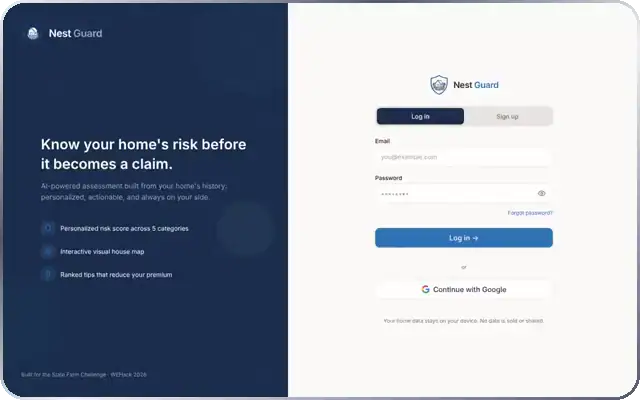</a>

<b>WEHACK 2026 · WINNER</b> &nbsp;·&nbsp; AI &amp; DATA · SOFTWARE

<h3>NestGuard</h3>

Home risk scores you can actually understand. FastAPI backend joining Census, FEMA and flood data, an <b>XGBoost</b> model explained with <b>SHAP</b>, and an LLM pipeline that turns homeowner reports into risk events.

<code>Python</code> <code>FastAPI</code> <code>XGBoost</code> <code>SHAP</code> <code>Gemini</code> <code>React</code>

<a href="https://www.nestguard.ink/">Live</a> &nbsp;·&nbsp; <a href="https://github.com/LinhTran00/nest-guard">Code</a> &nbsp;·&nbsp; <a href="https://devpost.com/software/nestguard">Devpost</a>

</td>
<td width="50%" valign="top">
<a href="https://github.com/linhtran00/posi-sense">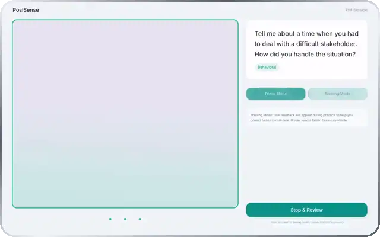</a>

<b>HACKAI 2026 · WINNER</b> &nbsp;·&nbsp; SOFTWARE · AI

<h3>PosiSense</h3>

A real-time AI interview coach. Tracks eye contact, blink rate and expression with the <b>Presage SmartSpectra SDK</b>, then gives per-answer scorecards and timestamped recaps.

<code>React</code> <code>Express</code> <code>MongoDB</code> <code>Docker</code> <code>C++</code> <code>Figma</code>

<a href="https://github.com/linhtran00/posi-sense">Code</a> &nbsp;·&nbsp; <a href="https://devpost.com/software/posisense">Devpost</a>

</td>
</tr>
<tr>
<td width="50%" valign="top">
<a href="https://github.com/wajdialjedaani/UnityPlugin">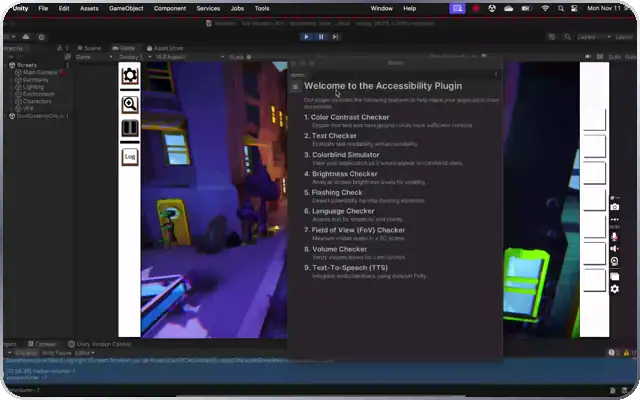</a>

SOFTWARE &nbsp;·&nbsp; MAY – DEC 2024

<h3>Unity Accessibility Plugin</h3>

<b>14 accessibility checks</b> inside the Unity editor: WCAG contrast, text, a colorblind simulator with 8 vision types, brightness, flashing and more. Auto CSV reports cut manual documentation by <b>40%</b>.

<code>C#</code> <code>Unity</code> <code>WCAG 2.1</code>

<a href="https://github.com/wajdialjedaani/UnityPlugin">Code</a>

</td>
<td width="50%" valign="top">
<a href="https://linhtran-my-portfolio.vercel.app/?role=ai#work">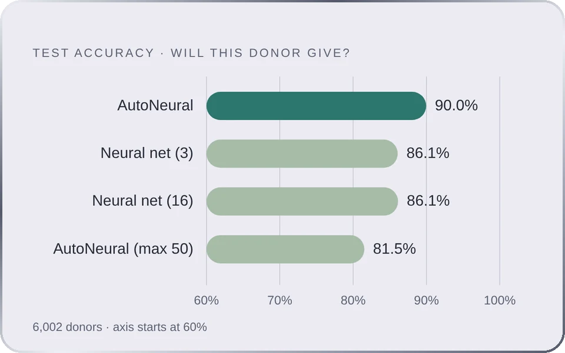</a>

AI &amp; DATA &nbsp;·&nbsp; SEP – DEC 2024

<h3>Donor Response Model</h3>

Which donors will give, and how much? Neural nets, KNN and decision trees in <b>SAS Enterprise Miner</b> on 6,002 donors: about <b>90% test accuracy</b> (ROC 0.96), +25% campaign profitability.

<code>SAS Enterprise Miner</code> <code>Neural networks</code> <code>KNN</code> <code>Regression</code>

<a href="https://linhtran-my-portfolio.vercel.app/?role=ai#work">Case study</a>

</td>
</tr>
<tr>
<td width="50%" valign="top">
<a href="https://adhd-study-planner.onrender.com/dashboard">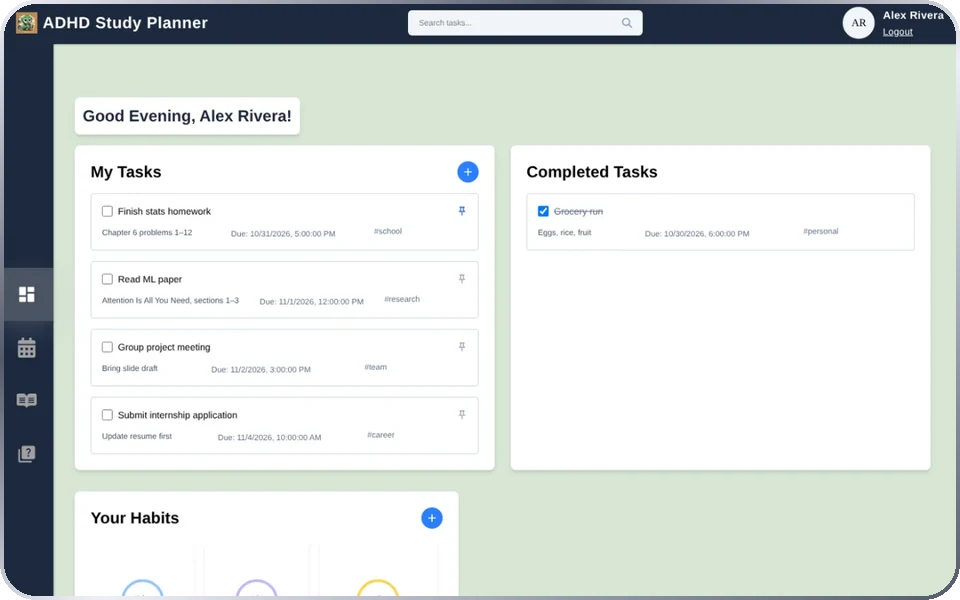</a>

SOFTWARE &nbsp;·&nbsp; JAN – MAY 2025

<h3>ADHD Study Planner</h3>

Tasks, habits, a calendar and a Pomodoro study room built for ADHD brains. I led the calendar and the self-screener; usability tests showed <b>+30% task completion</b>.

<code>React</code> <code>Tailwind</code> <code>MongoDB</code> <code>Express</code> <code>Gemini</code>

<a href="https://adhd-study-planner.onrender.com/dashboard">Live</a> &nbsp;·&nbsp; <a href="https://github.com/LinhTran00/ADHD">Code</a>

</td>
<td width="50%" valign="top">
<a href="https://pranitha-gaddam.github.io/UNT-Discovery-Park-Indoor-Navigation/">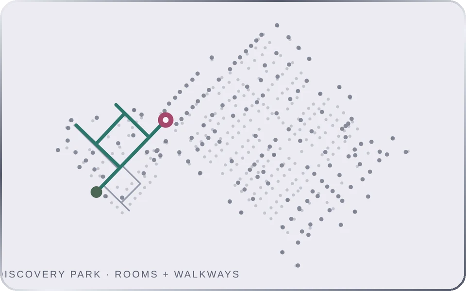</a>

SOFTWARE &nbsp;·&nbsp; JAN – MAY 2024

<h3>Indoor Navigation</h3>

Turn-by-turn routes inside UNT’s Discovery Park, with <b>wheelchair-friendly paths</b>. 417 mapped points across two floors from QGIS and OpenStreetMap.

<code>JavaScript</code> <code>Mapbox GL</code> <code>QGIS</code> <code>Figma</code>

<a href="https://pranitha-gaddam.github.io/UNT-Discovery-Park-Indoor-Navigation/">Live</a> &nbsp;·&nbsp; <a href="https://github.com/Pranitha-Gaddam/UNT-Discovery-Park-Indoor-Navigation">Code</a>

</td>
</tr>
<tr>
<td width="50%" valign="top">
<a href="https://github.com/LinhTran00/moodcast">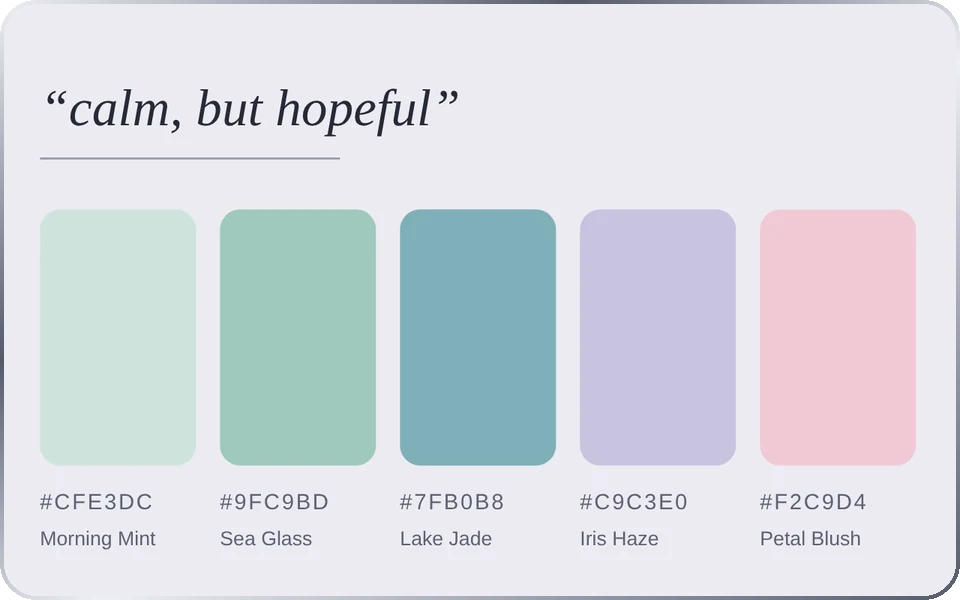</a>

AI &amp; DATA

<h3>Huemood</h3>

Describe a mood, get a palette. <b>GPT-4o</b> returns five colors as clean JSON, each with a hex code, a name and a usage role.

<code>Python</code> <code>OpenAI API</code> <code>Prompt design</code>

<a href="https://github.com/LinhTran00/moodcast">Code</a>

</td>
<td width="50%" valign="top">
<a href="https://linhtran-my-portfolio.vercel.app/?role=ai#work">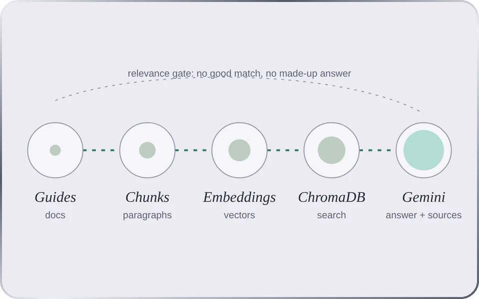</a>

AI &amp; DATA &nbsp;·&nbsp; CODEPATH AI201 · FALL 2026

<h3>Unofficial Guide RAG</h3>

A city guide you can ask questions, with sources. Chunk, embed, store in <b>ChromaDB</b>, answer with <b>Gemini</b>, and a relevance gate that refuses to make things up.

<code>Python</code> <code>ChromaDB</code> <code>Gemini API</code> <code>RAG</code>

<a href="https://linhtran-my-portfolio.vercel.app/?role=ai#work">Case study</a>

</td>
</tr>
</table>

<b>More work</b> &nbsp;statistics, reinforcement learning, analytics

 

| | Project | What happened |
|:--:|---|---|
| ∿ | **Steam Games Analysis** | ~99K games, regression on peak players. Best model adj. R² 0.237; adding all genres overfit. |
| ◐ | **Robot on a Cliff** | Value iteration on a 5×5 grid world with cliffs and slippery moves. |
| ⌘ | **Genetic Job Scheduler** | Order crossover + roulette selection beat random schedules by ~9%. |
| σ | **Bank of America 10-K** | 2015–2024 reports: CET1, LCR and deposit share vs. JPMorgan and Wells Fargo, in Tableau. |
| ◌ | **Purchase History** | 1M+ transactions from 5,000+ users. K-Means, Random Forest, CRISP-DM. |

 

<picture>
  <source media="(prefers-color-scheme: dark)" srcset="assets/title-path-dark.svg">
  
</picture>

| | When | Where | Role |
|:--:|---|---|---|
| ◉ | Now | **Handshake AI Fellowship** | AI Trainer · ranks AI-written Python and C/C++ |
| ◉ | Jun – Jul 2026 | **Texas DFPS** | Programmer Entry I Intern · Enterprise Architecture |
| ○ | 2026 – 2027 | **University of North Texas** | MS in Artificial Intelligence · 4.0 |
| ◉ | Jun – Aug 2025 | **Texas Comptroller** | Accessibility Compliance Intern · 25+ state sites audited |
| ○ | May 2025 | **University of North Texas** | BS in Computer Science · Data Analysis certificate |
| ◉ | Feb 2025 – now | **Wize Computing Academy** | Teaching Assistant · 50+ young coders |
| ◉ | May – Sep 2024 | **American Foundation for the Blind** | Digital Accessibility Intern |

 

<picture>
  <source media="(prefers-color-scheme: dark)" srcset="assets/title-toolkit-dark.svg">
  
</picture>

<table>
<tr>
<td width="50%" valign="top">

<b>AI &amp; DATA</b>

</td>
<td width="50%" valign="top">

<b>SOFTWARE</b>

</td>
</tr>
</table>

 

<picture>
  <source media="(prefers-color-scheme: dark)" srcset="assets/title-beyond-dark.svg">
  
</picture>

| **50+** | **+209%** | **24h** | **2×** |
|:--:|:--:|:--:|:--:|
| young coders at **Wize Computing Academy**: Python, p5.js, Flask, Django, robotics | Instagram reach for **Women in Computing** at UNT (+73.9% on LinkedIn) | **HackUNT 2027** · Challenge Lead on the leadership team | hackathon wins: **HackAI 2026** and **WEHack 2026** |

 

<picture>
  <source media="(prefers-color-scheme: dark)" srcset="assets/title-stats-dark.svg">
  
</picture>

<picture>
  <source media="(prefers-color-scheme: dark)" srcset="https://github-readme-stats.vercel.app/api?username=LinhTran00&show_icons=true&hide_border=true&bg_color=00000000&title_color=86e3d5&text_color=a3b6b9&icon_color=5fd0c0&ring_color=5fd0c0">
  
</picture>
<picture>
  <source media="(prefers-color-scheme: dark)" srcset="https://github-readme-stats.vercel.app/api/top-langs/?username=LinhTran00&layout=compact&hide_border=true&bg_color=00000000&title_color=86e3d5&text_color=a3b6b9">
  
</picture>
 
<picture>
  <source media="(prefers-color-scheme: dark)" srcset="https://github-readme-activity-graph.vercel.app/graph?username=LinhTran00&bg_color=00000000&color=a3b6b9&line=5fd0c0&point=e7a6ba&area=true&area_color=5fd0c0&hide_border=true&title_color=86e3d5">
  
</picture>

 

<picture>
  <source media="(prefers-color-scheme: dark)" srcset="assets/title-hello-dark.svg">
  
</picture>

**Let’s build something calm.**

  

Cảm ơn for visiting

